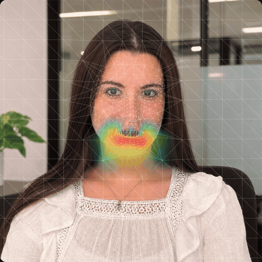

# avatar_lipsync

Real-time lip sync for Flutter: a talking avatar driven by streamed speech.
Show a drawn face on any platform, or bring a single frontal photo to life
on the web.

**[Live demo: lipsync.azanello.com](https://lipsync.azanello.com)**: turn on
your microphone and the photo lip-syncs to your voice.

<p align="center">
  
  
</p>
<p align="center"><sub>Photo: <a href="https://www.instagram.com/micaela_valente/">@micaela_valente</a>. Right: the rig overlay (mesh and live-motion heat map).</sub></p>

- **Works ahead of the sound.** Each audio chunk is analysed when it is
  scheduled, before it is heard, so the mouth is never late.
- **A real mouth model.** The jaw follows loudness and the lips follow
  articulation (JALI): vowel shapes, rounding, lip closures for m/b/p, and
  springs for natural motion. It adapts to each speaker's voice.
- **One photo is enough.** `PhotoLipSyncAvatar` finds 478 face points with
  MediaPipe (loaded in the browser at runtime) and animates the photo as a
  mesh, with teeth and tongue painted in colors taken from the photo.
- **Alive.** It blinks, sways, nods, raises its brows and shifts its gaze, and
  respects the reduced-motion setting.
- **Any audio stack.** You connect your player through one small interface.
  The package itself does not play audio.

## Install

```sh
flutter pub add avatar_lipsync
```

## Quick start

### 1. Tell the avatar what is being heard

Implement `LipSyncSource` over your audio player. This is the smallest one:
it keeps time with a `Stopwatch` and is enough to try the package.

```dart
import 'dart:async';
import 'dart:typed_data';

import 'package:avatar_lipsync/avatar_lipsync.dart';

class ClockSpeechSource implements LipSyncSource {
  final _clock = Stopwatch()..start();
  final _chunks = StreamController<SpeechChunk>.broadcast();
  final _flushes = StreamController<double>.broadcast();

  @override
  Stream<SpeechChunk> get chunks => _chunks.stream;

  @override
  Stream<double> get flushes => _flushes.stream;

  @override
  double? get audibleTime => _clock.elapsedMicroseconds / 1e6;

  /// Mono samples in -1..1, starting now.
  void speak(Float32List samples, int sampleRate) => _chunks.add(
    SpeechChunk(
      samples: samples,
      startTime: audibleTime! + 0.05,
      sampleRate: sampleRate,
    ),
  );

  /// The user interrupted: close the mouth.
  void stop() => _flushes.add(audibleTime!);
}
```

With a real player, the rules are:

1. Emit each chunk on `chunks` **when you schedule it**, before it sounds,
   with `startTime` on the player's clock.
2. `audibleTime` is that same clock right now, minus the output latency, or
   `null` while nothing plays.
3. Emit the cut time on `flushes` when playback is interrupted.

[`example/lib/sources/web_audio_speech_source.dart`](example/lib/sources/web_audio_speech_source.dart)
does this over Web Audio in about 150 lines.

### Realtime voice models (OpenAI Realtime, Gemini Live)

I built this to give a face to voice bots running on realtime models. Both
APIs stream the model's voice as base64 PCM16, mono, 24 kHz: hand each chunk
to your source the moment it arrives, and stop on barge-in.
`pcm16ToSamples` converts the bytes; the example's
[`WebAudioSpeechSource`](example/lib/sources/web_audio_speech_source.dart)
wraps it as `playPcm16`.

**Gemini Live** (every server message from your WebSocket or SDK):

```dart
void onGeminiMessage(WebAudioSpeechSource source, Map<String, Object?> msg) {
  if (msg case {'serverContent': {'interrupted': true}}) {
    return source.stop(); // barge-in
  }
  if (msg case {
    'serverContent': {'modelTurn': {'parts': final List<Object?> parts}},
  }) {
    for (final part in parts) {
      if (part case {'inlineData': {'data': final String audio}}) {
        unawaited(source.playPcm16(base64Decode(audio), 24000));
      }
    }
  }
}
```

**OpenAI Realtime** (WebSocket transport; over WebRTC the audio arrives as a
media track and its samples are not available):

```dart
void onOpenAIEvent(WebAudioSpeechSource source, Map<String, Object?> event) {
  switch (event) {
    // 'response.audio.delta' is the beta API's name for the same event.
    case {
      'type': 'response.output_audio.delta' || 'response.audio.delta',
      'delta': final String audio,
    }:
      unawaited(source.playPcm16(base64Decode(audio), 24000));
    case {'type': 'input_audio_buffer.speech_started'}: // the user talks
      source.stop();
  }
}
```

Both are in [`example/lib/realtime_recipes.dart`](example/lib/realtime_recipes.dart).

Tips:

- Schedule each chunk the moment it arrives, not when it plays.
- On barge-in, also tell the model how much was heard (OpenAI:
  `conversation.item.truncate`), so its transcript matches what was played.
- Mount the avatar before the first chunk arrives.

### 2. Show a face

A drawn face, on every platform:

```dart
LipSyncAvatar(
  source: source,
  colors: const LipSyncAvatarColors(
    face: Color(0xFFF2D3B3),
    ink: Color(0xFF3B2A20),
    mouth: Color(0xFF6B1F2A),
  ),
  size: 200,
)
```

A photo, on the web. Use a frontal face with the mouth closed, declared as an
asset in your `pubspec.yaml`:

```dart
PhotoLipSyncAvatar(
  source: source,
  imageAsset: 'assets/face.jpg',
  // Shown off the web, or if no face is found.
  fallback: LipSyncAvatar(source: source, colors: myColors),
)
```

### See the rig

`PhotoLipSyncAvatar` can draw how it animates the photo: the triangle mesh,
the 478 MediaPipe landmarks, and a heat map of what moves.

```dart
PhotoLipSyncAvatar(
  source: source,
  imageAsset: 'assets/face.jpg',
  overlay: const RigOverlay(
    mesh: true,
    landmarks: true,
    heat: RigRegion.motion, // or jaw, lips, corners, eyelids, brows, head
  ),
)
```

`RigRegion.motion` shows how far each point moves right now, with the
head's own sway taken out, so you see the mouth, lids and brows working.
The other regions show the rig's weight fields (`FaceRig.weights`).

### 3. Drive your own character

Both widgets call `onFrame` with a `LipSyncFrame` on every animation frame:
`jaw`, `gap`, `width`, `round`, `press`, `level`, `speaking` and the dominant
`viseme`. Use them to drive a Rive state machine, sprites or a 3D rig:

```dart
LipSyncAvatar(
  source: source,
  colors: myColors,
  onFrame: (frame) {
    visemeInput.value = frame.viseme.index.toDouble();
    openInput.value = frame.mouthOpen;
  },
)
```

To skip the widgets entirely, run `LipSyncDriver(source)` and call
`tick(dt)` from your own `Ticker`.

## Mirror the microphone

[`example/lib/sources/mic_speech_source.dart`](example/lib/sources/mic_speech_source.dart)
is a `LipSyncSource` over the microphone, the one the live demo uses. An
AudioWorklet hands over 20 ms chunks and nothing is played back, so the
avatar mirrors whoever talks with no echo.

## Example

[`example/`](example) is a Flutter web app with synthetic speech, audio file
playback, and both faces:

```sh
cd example && flutter run -d chrome
```

## Platforms

| Feature | Web | Android, iOS, desktop |
| --- | --- | --- |
| Speech analysis, `LipSyncFrame`, `onFrame` | ✅ | ✅ |
| `LipSyncAvatar` (drawn face) | ✅ | ✅ |
| `PhotoLipSyncAvatar` (photo rig) | ✅ | Shows `fallback` |

The photo rig loads MediaPipe Tasks Vision 0.10.14 and its face model from
public CDNs the first time a photo is rigged, so the page needs network
access to `cdn.jsdelivr.net` and `storage.googleapis.com`.

## How it works

```
LipSyncSource ──chunks──▶ SpeechTimeline ──▶ LipSyncAnalyzer ──▶ LipSyncFrame
   (your player)          FFT per 10 ms:      jaw, lips, viseme      │
                          level, formants,    springs, 30 ms lead    ▼
                          hiss, nasal, flux               LipSyncAvatar /
                                                          PhotoLipSyncAvatar
                                                          (+ AvatarMotion, FaceRig)
```

- `SpeechTimeline` analyses each scheduled chunk (25 ms Hann window, 10 ms hop,
  FFT): level, first and second formant estimates, hiss, nasal energy and
  spectral flux.
- `LipSyncAnalyzer` reads the timeline 30 ms ahead of what is heard. Vowel
  shapes are soft blends normalised to the speaker, shapes coarticulate, stop
  closures are anticipated, and the jaw and lip gap move as springs.
- `FaceRig` builds a Delaunay mesh over the photo with weight fields for the
  jaw, lips, corners, eyelids, brows, irises and head, and
  `PhotoLipSyncAvatar` draws it with `Canvas.drawVertices`.

## Contributing

```sh
flutter pub get
flutter analyze
flutter test
```

Tuning tools (instructions in each file header):

- `test/src/viseme_calibration_test.dart` runs a WAV file or a labelled
  consonant corpus through the pipeline and prints a report.
- `test/src/photo_preview_test.dart` renders mouth shapes on the photo to PNG.

Working with an AI coding agent? See [AGENTS.md](AGENTS.md).

## Credits

- Demo and README photo: [@micaela_valente](https://www.instagram.com/micaela_valente/),
  used with permission. It is not part of the published package.
- `test/fixtures/face.jpg` and `example/assets/face.jpg`: "Portrait de Blanche
  Angers, actrice" (Bacard fils, Paris, c. 1880), Paris Musées / Musée
  Carnavalet, CC0, via
  [Wikimedia Commons](https://commons.wikimedia.org/wiki/File:Portrait_de_Blanche_Angers,_actrice,_PH41663.jpg).
- [MediaPipe](https://github.com/google-ai-edge/mediapipe) Tasks Vision
  (Apache 2.0) is loaded from a CDN at runtime, not bundled.

## License

MIT. See [LICENSE](LICENSE).
